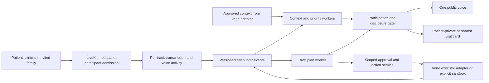

# Bring Vene — build blueprint

Research and design: 12 October 2026.

Status: a build design, source audit and proposed integration contract. No live product, clinical validation, external service integration or access to Vene's private code is claimed. Public repository source was inspected but not installed or executed. The user has accepted Bring Vene; this document develops it rather than reopening idea selection.

## The product we should build

**Bring Vene lets a patient take their existing assistant into a healthcare conversation, use its memory while the right people are present, and carry the clarified next steps directly into follow-through.**

The ambitious version has a continuous experience: prepare with me, help me in the conversation, check whether the administrative steps are workable, and keep the approved work moving afterward. Its main interface is the conversation. A small live visit card makes its understanding visible and correctable.

The strongest addition to the previous proposal is **checking practical feasibility while the plan is still being discussed**. For example, if an authorized scheduling lookup returns availability outside the timeframe the clinician just gave, Vene can bring that specific obstacle back into the conversation. The clinician decides what that means for care. Vene does not discover the obstacle days later and leave the patient carrying messages between people.

This is our product judgment, not a claim of global novelty. A patient-side AI visit companion already has close precedents. The distinctive contribution for Vene would be the quality of the connection between its existing memory, the live encounter, and its existing execution.

## Why this belongs inside Vene

Vene publicly describes connected records, personal context, approved administrative errands and scoped family updates. It says clinicians retain medical decisions and patients approve tasks. Those are the assets Bring Vene should extend. [Company workflow](https://www.venehealth.com/how-vene-works).

Its consumer page says there is no new app to install and the doctor needs no account. Therefore the actual feature should begin in Vene's familiar conversation, use an optional secure browser link, and avoid creating a separate clinician portal. A hosted room is a useful first implementation and demonstration surface; it is not proof that every clinic will move visits into it. [Consumer offering](https://www.venehealth.com/consumer).

Vene lists LiveKit, Twilio, Deepgram, Cartesia, ElevenLabs and Zep in its privacy policy. It says audio is processed live without being stored, while transcripts persist. This supports using compatible building blocks and preserving that retention model; it does not reveal the private architecture. [Privacy policy](https://www.venehealth.com/privacy).

For a care organization, an invited call involving the patient and a staff member is a plausible initial surface. Vene already describes named staff ownership and escalation. This is an adoption hypothesis, not a known customer request. [Care organizations](https://www.venehealth.com/for-care-organizations).

## Six connected capabilities

### 1. Arrive knowing what this patient wants from this conversation

Preparation should produce a short, patient-approved agenda, not a biography.

Vene combines the appointment purpose, relevant source records, prior conversations and unresolved errands. It proposes two or three priorities and asks which matter today. Each priority has a desired resolution: an answer, a decision from a clinician, a named owner, or a practical next step.

The patient can say, “Ask about the referral, but do not mention the family issue.” A relative can suggest a question; their suggestion does not silently become the patient's agenda. Preferences and reports carry their dates and sources so that old context is not presented as current.

The useful memory is selective. The public speaking component only receives facts that can be shared with the people currently present. A separate patient-private component can offer a suggestion without exposing its underlying private context to the room.

### 2. Be an effective participant, with useful initiative

Support three understandable modes:

- **Help when asked:** respond to an explicit invitation.
- **Help me remember:** privately surface an approved priority when relevant; the patient can ask Vene to raise it.
- **Help us close:** with agreement to this mode, offer a brief closeout at an appropriate pause, covering unresolved patient priorities and practical ambiguities.

The second mode is the initial default for a patient with a private screen. Proactive suggestions can be useful without repeatedly interrupting the clinician. If the patient has only a telephone, do not pretend a private visual channel exists; use the agreed spoken mode.

Separate two judgments: “Is this worth bringing up?” and “Is this an appropriate moment to speak?” Ending a sentence does not automatically give Vene the floor. Candidate interventions expire if the conversation has already answered them. Patient and clinician speech can cancel queued output.

For factual recall, Vene can answer, “The pharmacy message from Monday says the request was still pending.” It should not flatten that into “Your prescription was never sent.” The source and its age change the meaning.

A large **Pause Vene** control and a clear spoken stop instruction are part of the normal experience. Pausing processing is different from merely silencing its voice. After processing is paused, resume through an explicit control rather than secretly continuing to listen for a wake word.

### 3. Check practical obstacles before everyone leaves

This is the flagship extension.

As an administrative plan emerges, a background worker can perform a narrowly approved check: an office's opening hours, whether a scheduling request has a required document, or currently offered appointment slots. Personal information is disclosed only within the authorization for that check. Calls, portal messages and other external outreach require the corresponding approval; “read-only” does not mean consequence-free.

It can combine a current result with an approved personal constraint. For example:

> The clinician requested a follow-up within a specified window. The scheduling service currently offers no slot in that window. Vene asks whether the office should handle scheduling directly.

Vene does not decide that a later appointment is medically acceptable. It does not select a different test or treatment. It supplies the concrete logistical fact while someone with the relevant authority can respond.

These checks run alongside the conversation. They never block listening or require the clinician to wait for a slow portal. If the result arrives after the visit, it becomes follow-up work with an explicit unresolved dependency.

For the independent prototype, the scheduler is an actual local sandbox service with controllable availability and signed-order requirements. It returns real responses and receipts within that sandbox. Label it clearly. Do not present fabricated provider access as a live integration.

### 4. Make the emerging plan visible and correctable

The live visit card has three areas:

| Area | What it shows |
|---|---|
| What I wanted to discuss | Patient-approved priorities, with answered, partly answered, deferred or open status |
| What we understood | Proposed next steps, source statements, owner and timeframe; clearly marked as a draft |
| What still needs to happen | Approval, clinical confirmation, required order, scheduling or another dependency |

The card is generated from structured state, not freshly rewritten from scratch on every token. Only changed items move. A correction such as “Tuesday, not Thursday” updates the affected item and invalidates stale downstream proposals.

A clinician can clarify verbally. An optional guest view can show the shared plan without requiring a new account. Patient confirmation establishes that this reflects their understanding; it does not create a signed order or prove medical correctness.

This is a coordination view, not a clinical decision support display. Avoid treatment recommendations, diagnostic confidence meters and broad alerts. Use plain labels such as “Waiting for the office's order” and “Appointment not yet booked.”

### 5. Continue with the same context after the conversation

At the end, Vene proposes the specific administrative actions it can take. The patient approves the scope, relevant information sharing and any meaningful limits. Already authorized actions need not be repeatedly re-approved unless their material terms change.

A plan item can be discussed without being executable. Keep these distinct:

- An utterance was captured.
- A draft interpretation was made.
- The appropriate person clarified or confirmed it.
- A required clinical document or order is available.
- The patient authorized a particular administrative action.
- A third party accepted a request or confirmed a result.

Use separate fields for these facts rather than forcing every item through one linear status. Some errands need an order; others do not.

If an official after-visit document later differs from the conversation, show the source difference and ask the appropriate person to resolve it. Do not declare one version clinically correct just because it is newer. Do not automatically start, stop or change medication.

Family members receive the approved update, such as the booked time and transport request, rather than the entire transcript by default. At the next visit, Vene can prepare a concise account of what changed and what remains open, with renewed sharing scope.

### 6. Follow the patient across conversation surfaces

Use one encounter model behind several adapters:

| Surface | Implementation role | Limit |
|---|---|---|
| Invited browser conversation | First working demonstration; separate tracks for each remote participant | Requires participants to use that link |
| Telephone conference | Fit with Vene's existing calls; patient and office can be SIP participants | Test carrier, conference, identity and admission behavior; not arbitrary access to native calls |
| In-person phone on the table | Important patient-facing expansion with disclosed processing | Mixed audio, echo and ambiguous speaker attribution require separate testing |
| Existing Meet/Teams/Zoom visit | Later meeting adapter when the host permits an AI participant | Platform support and permissions vary; no universal join promise |

LiveKit documents rooms containing both WebRTC and SIP participants, and bridging a Twilio conference through SIP. These establish transport options, not a completed Bring Vene integration. [Telephony setup](https://docs.livekit.io/telephony/accepting-calls/workflow-setup/), [Twilio integration](https://docs.livekit.io/telephony/accepting-calls/inbound-twilio/).

Do not make all four surfaces a prerequisite for demonstrating the product. Build the full experience on one surface, then prove the next adapter. A static summary demo would be too little; four unproven transports would obscure the actual feature.

## The founder demonstration

Use a fictional patient and consenting actors. The founder can change the conversation rather than watching a recording.

1. **Preparation:** Maria approves two questions and a scheduling constraint. A separate fact is private. Her daughter has suggested another question that Maria chooses not to include.
2. **Natural conversation:** Maria and the clinician speak. Vene updates the visit card and stays out of turns directed at Maria.
3. **Memory in the moment:** Maria asks for help recalling the referral problem. Vene brings the relevant dated message, not a generic summary of her chart.
4. **Live practical check:** within prior scope, the sandbox scheduler returns no appointment in the clinician's requested window. Vene privately proposes a concise question; Maria invites it to ask. The clinician names the office staff member who will handle it.
5. **Unscripted correction:** the founder changes the location, date or owner. The displayed plan changes, and the pending action using the old value becomes stale.
6. **Follow-through:** Maria approves the remaining errands. One completes against the sandbox and produces a receipt. Another remains visibly dependent on the office's order. Her daughter sees only the update Maria approved.
7. **Continuity:** a synthetic later office response advances the outstanding item. A conflicting after-visit instruction is surfaced for human clarification, not silently resolved.

The impressive moment is not the number of agents. It is the system noticing a useful connection, contributing appropriately, adapting to a human correction, and carrying the resulting work forward.

## Implementation architecture

Use LiveKit Agents as the media/voice foundation and a custom Next.js interface built with LiveKit components, borrowing the licensed Meet pre-join and room patterns. Python handles the encounter service and asynchronous workers; Postgres stores the encounter state and action outbox. Those are proposed choices, not assumptions about Vene's private stack.

Keep speech providers and the model behind interfaces. Match Vene's disclosed providers where practical. Do not choose a model purely by a leaderboard or train a new model before measuring the actual interaction.



These are responsibility boundaries, not a mandate for a separate service or language model for every box. The product has one recognizable public voice. Background work can run concurrently without several assistants talking over one another.

### Media and conversation timing

- Maintain a transcription stream for each admitted remote track. Retain participant ID, track/session epoch, utterance ID, time range, revision and finality.
- Maintain overlap and active-speaker state; do not fabricate a total order for overlapping speech.
- The official LiveKit multiparty transcription example is a starting pattern. It disables voice generation per participant. The speaking path should consume the shared approved encounter state rather than run several independent conversational agents.
- A stock AgentSession links to one participant. Simply placing it in a room is insufficient. [Linked participant documentation](https://docs.livekit.io/agents/logic/sessions/).
- Gate public speech explicitly. A fast local control path handles mute, stop, consent change and cancellation; it must not wait behind a model or slow tool.
- Build short candidate utterances ahead of likely opportunities, but recheck their event version, audience, permission and relevance before playback. Discard them when stale.
- Confirm the SDK's actually played speech boundary after an interruption; do not store an unspoken sentence as if the room heard it.
- In the first separated-track build, stop on human speech and tune backchannel handling from observed sessions. Do not assume ordinary two-person interruption settings solve a multiparty room.

### Context and reasoning

Use separate inputs for shared and private output:

- **Patient-private reasoning:** approved access to personal context; emits suggestions only to the patient's authenticated view.
- **Shared reasoning:** receives only material allowed for the present audience and current purpose.
- **Plan extraction:** produces proposed changes with evidence references; cannot independently dispatch actions.
- **Practical lookup worker:** calls only tools allowed by task scope; returns dated results, missing prerequisites and expiry.
- **Participation controller:** decides whether to remain silent, show a private cue, answer an invitation or offer an agreed closeout.

Structured model outputs carry proposed facts, relevant evidence IDs, affected plan item, intended audience and reason category. They do not carry authority merely because they pass JSON validation. Check the cited evidence and permissions in application code.

Retrieved documents, transcripts and external tool responses are data, not system instructions. A participant or document cannot change another person's access rights or grant tool permission by telling the model to do so.

Start with a cached, bounded visit context and incremental updates. Refresh when a relevant fact changes. Running a large reasoning call on every audio frame would add cost and latency without helping the experience.

### Stored entities

| Entity | Essential fields |
|---|---|
| Participant | Server-issued identity, claimed/invited role, identity verification method, encounter membership |
| Permission | Purpose, audience, allowed fields/actions, version, scope, expiry, revocation |
| Evidence | Source type and ID, timestamp, exact span/reference, capture revision, reported versus imported versus third-party confirmed |
| Priority | Patient approval, desired resolution, discussion status, supporting evidence |
| Plan item | Kind, draft wording, owner, timeframe, dependencies, evidence, confirmation state, version |
| Action | Exact request, authorization reference, request hash, dependency versions, idempotency key, attempts and receipt |
| Encounter | Processing state, participant set, current event sequence, transcript gaps, retention policy |

A speaker label is not authentication. A patient calling someone “Doctor” is not credential verification. Clinical documents retain their source and normal verification path.

### Proposed integration seam

Expose domain operations rather than couple the module to a particular memory or EHR implementation:

```text
ContextAdapter.get_visit_context(patient_ref, purpose, scope)
ContextAdapter.get_evidence(evidence_refs, audience, scope)
EncounterService.append_event(encounter_id, event, expected_version)
EncounterService.get_view(encounter_id, viewer_identity)
ExecutionAdapter.check_prerequisites(action_draft, scope)
ExecutionAdapter.submit(action, authorization_ref, idempotency_key)
ExecutionAdapter.get_result(external_action_ref)
NotificationAdapter.deliver(approved_message, recipient_scope)
```

These are proposed interfaces, not existing Vene endpoints. The independent build supplies synthetic context, a controllable scheduler and a message outbox. Vene integration would replace those adapters after access becomes available; it would not require rewriting its memory or errands.

## Engineering details that matter to the experience

**Corrections propagate.** A changed source utterance increments its version, supersedes affected draft claims and invalidates actions depending on them. A material change after approval requires a fresh scoped approval. If an external action has already happened, show the result and propose a correction; do not pretend an event rollback undid the outside world.

**Requests are durable.** Commit an approved action and its outbox entry together. Use idempotency where the downstream service supports it. After an ambiguous external timeout, reconcile before retrying a booking or message. Do not promise exactly-once delivery through arbitrary phone calls or websites.

**Private means absent from other clients.** Filter server-side. Do not send every fact to the room and hide cards with CSS. Keep private suggestions off shared transcript channels. The inspected LiveKit legacy transcription publisher broadcasts without a destination argument; disable automatic transcript publication where selective delivery is required.

**Permissions apply at use time.** Recheck before retrieval, display, speech and action dispatch. Revocation cancels outstanding generation and playback, closes the relevant processing path and prevents later writes from an old permission epoch. Information already heard cannot be withdrawn from someone's memory.

**Loss of audio is visible.** Reconnect with a new track epoch, mark gaps and ask for repetition of consequential missing instructions. Do not infer a missing sentence from likely context.

**Preserve Vene's audio policy.** Avoid recording/egress and raw-audio persistence by default. Remove transcript text from ordinary logs; segregate required transcript storage and restrict access. The source example logs transcript text, so it cannot be copied unchanged.

**No broad tool access.** Use typed administrative operations with authorization checks, not an unrestricted browser or shell available to the speaking model. External page content must not be able to authorize new work.

**Admission is real application work.** Replace example token endpoints with authenticated, encounter-scoped admission. Room name, role and audience come from the server's membership record, not arbitrary client-supplied metadata. A no-account guest link can be short-lived and scoped without being a public room.

These requirements support the patient experience; they should not become a checklist the patient must navigate.

## Research that changed the design

Recent multiparty research treats deciding when to speak as a separate capability from answering well. MP-Bench tests speaker understanding and turn-taking in synthetic discussions and games; it is not a healthcare evaluation. Its abstract and HTML currently report different headline comprehension figures, so no performance number is used here. The design takeaway is to evaluate silence, attribution and interruption separately. [Paper](https://arxiv.org/html/2609.13076v1).

When2Speak likewise studies intervention timing using grounded synthetic conversations. It supports exploring a learned participation policy later, but does not establish that its data or rewards transfer to older patients' visits. A trainable policy is an optional later improvement, not a prerequisite for the feature. [Paper](https://arxiv.org/abs/2605.05626).

The ICAN research provides a useful precedent for bringing patients' workload and capacity into care conversations. Its larger cluster-randomized trial found no clear consistent benefit across most measured outcomes and reported limited uptake. Therefore we should not claim that exposing practical constraints automatically improves care. Build for low-friction use and measure actual benefit. [Trial](https://pmc.ncbi.nlm.nih.gov/articles/PMC11616879/).

The earlier digital-consultation interview study found substantial physician reluctance toward a communicative digital expert. This remains a reason to make the role clear and the contribution brief. It is not a reason to reduce the feature to passive transcription, nor proof that our interaction design will be accepted. [Study](https://humanfactors.jmir.org/2024/1/e49647/).

TEN's diarization example offers a relevant international reference: labeled speakers can feed a shared conversation. It uses a speech provider and even documents configuration options that are not functional in the pinned setup. We should borrow the interaction insight, not treat a README's speaker labels as reliable identity. [Example](https://github.com/TEN-framework/ten-framework/tree/c6cbeebbf9a3fb6a3f9ed245359d72c792840d00/ai_agents/agents/examples/speaker-diarization).

## Build sequence and definition of done

### Milestone 1 — the encounter foundation

Build server-issued invitations, patient scope selection, a browser room with two human participants and a visibly disclosed Vene participant, per-track transcription, pause/resume and typed manual events. Build the event store and filtered patient/shared views.

Done when join/leave, reconnection, simultaneous speech and pause behavior work with two real microphones, and another participant cannot retrieve private context. This is an internal foundation, not the founder demo.

### Milestone 2 — memory and participation

Add preparation from synthetic records, patient-approved priorities, sourced factual recall, private cues, invited public speech and explicit closeout.

Done when unscripted humans can discuss an unrelated topic without Vene replying to every utterance; the right priority is surfaced when relevant; source-backed recall survives corrections.

### Milestone 3 — the flagship feature

Add the local scheduling service, a live administrative prerequisite check, the updating plan card, scoped approval and action receipts. Show pending work honestly.

Done when the exact founder demonstration works end to end and a founder-introduced change actually changes the plan and resulting action. This is the first version worth showing.

### Milestone 4 — continuity and the next access surface

Add the office-response event, after-visit document differences, filtered family update and next-visit preparation. Then add telephone participation using the same encounter model.

Done when a restart does not lose approved work, duplicate callbacks do not create duplicate tasks, late replies update the correct item, and telephone behavior is measured rather than assumed.

### Milestone 5 — shared microphone and field readiness

Evaluate in-person capture, accents, overlap, echo, permission withdrawal, clinician acceptance and accessibility with an appropriate controlled process. Add accepted meeting-platform adapters only if they reduce actual adoption friction.

Clinical/operational review, deployment agreements and validation precede real patient use. Open-source licenses or transport security alone do not establish clinical or regulatory readiness.

## The evidence the demonstration should produce

Use synthetic encounters and consenting actors. Include a fixed scenario set plus unscripted sessions. Review transcripts and observed interactions, not only automated scores.

- Which patient priorities were answered, deferred or left open?
- How many factual statements lacked supporting evidence?
- Did Vene speak when the humans did not want it to?
- Did a private cue help the patient ask a useful question?
- Were logistical obstacles clarified before the encounter ended?
- Did the correct approved actions execute, with valid receipts?
- Did any private information appear in the wrong participant's view, speech or logs?
- Did corrections, cancellation, missing orders and ambiguous timeouts behave correctly?
- How much delay and extra encounter time did the feature introduce?

Provisional engineering targets for the controlled prototype: public reply begins within roughly two seconds at the 95th percentile after an explicit invitation, and playback cancellation completes within roughly half a second at the 95th percentile after a stop is detected. Instrument speech endpointing and stop-recognition delay separately so those targets cannot hide slow detection. These are targets to test, not measured results or clinical standards.

Zero unauthorized disclosures and zero action dispatches without valid scope are release gates in the controlled suite; passing the suite is not a claim of zero real-world risk. Critical failures stop expansion until repaired.

Compare the completed experience against good preparation plus passive capture during validation. That is evidence gathering, not the product pitch and not a restriction on how ambitious the implementation can be.

## Recommendation

Build the complete encounter loop on LiveKit: approved memory, useful participation, one live practical check, a correctable visit plan and real sandbox follow-through. Demonstrate that loop before adding more transports or languages.

The product promise is: **Vene can come with you, help the conversation resolve what matters, and leave with the right work already understood.**

The source and license findings, including what cannot be reused as-is, are in BRING_VENE_REPO_AUDIT_2026-10-12.md.

