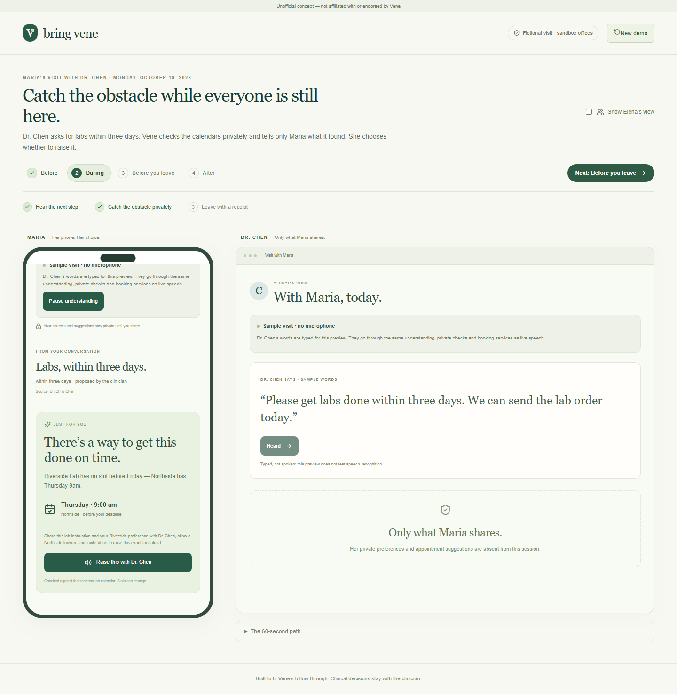

# Bring Vene

**Catch follow-through problems while the patient and doctor are still together.**

[Open the demo](https://bring-vene-concept.onrender.com/demo) · [Explore the full workspace](https://bring-vene-concept.onrender.com/dev)

A doctor asks for labs within three days. The patient's usual lab has no appointment in time. Bring Vene finds an alternative during the visit, tells the patient privately, and helps them raise it while the doctor can still change the plan. The doctor confirms the order; the patient approves booking; the office returns a receipt.

Bring Vene is an independent, unofficial concept built with Vene Health in mind. It is not affiliated with or endorsed by Vene. All patients, medical information, offices, health plans and appointments in the demo are fictional.

## Walk through one visit

Open the demo and select **Start demo**. Maria's phone and Dr. Chen's window use separate authenticated sessions. **Show Elena's view** opens the family view.

| Part of the visit | What happens |
| --- | --- |
| **Before** | Unfinished tasks and unanswered questions from Maria's earlier visit become suggestions. She chooses and approves what goes on the doctor's visit list. |
| **During** | A lab deadline conflicts with availability. Maria receives a private alternative, chooses to raise it, and approves the reservation after Dr. Chen confirms the order. |
| **Before you leave** | The doctor adds an MRI and a prescription. Vene catches a prior-authorization requirement. Each task waits for its own prerequisites and approval, then receives its own office result. |
| **After** | Maria can send confirmed steps and their supporting notes to Elena, then ask for a ride. Elena answers for herself. Unanswered questions remain available for the next visit. |

The hosted walkthrough uses labelled sample text and an optional device voice preview. It runs the application's domain services against sandbox institutions. It does not contact real providers, pharmacies, insurers or family members. The free hosting service may take a little time to wake up.

<details>
<summary>See the during-visit screen</summary>



</details>

## What is implemented

- **Patient-controlled sharing.** Questions, sources, plans and private cues have separate audiences. Unauthorized content is omitted from API responses and live updates, rather than hidden only in the interface.
- **Consent-gated conversation.** Local LiveKit calls support individual agreement, processing pause, interruption and a one-phone room mode. Raw audio is unrecorded by default.
- **Sourced understanding.** Transcript and model outputs propose next steps with evidence references. People can correct what was heard; dependent pending work loses its prior approval.
- **Practical checks.** Sandbox calendars, coverage, pharmacy stock and referral requirements produce administrative findings. Clinical decisions remain with the clinician.
- **Separate authority for each action.** A model proposal, clinician confirmation, required order, patient approval and external completion are different records.
- **Durable follow-through.** PostgreSQL outboxes, idempotency keys, signed callbacks and receipt reconciliation handle retries and uncertain outcomes. An unanswered request stays unknown; a local edit does not cancel an external booking.
- **Continuity.** Private next-visit preparation, bounded PDF/text comparison, scoped family updates and independently answered ride requests share the same backend.

## Architecture

| Layer | Implementation |
| --- | --- |
| Web application | Next.js, React and TypeScript; a same-origin API proxy; generated API types |
| Application API | Python 3.12, FastAPI and Pydantic; session, audience and command authorization |
| Persistence | PostgreSQL, SQLAlchemy and Alembic; versioned visit state and transactional outboxes |
| Live updates | Authenticated, participant-filtered server-sent events |
| Voice | LiveKit / LiveKit Agents; Deepgram speech recognition; DeepSeek understanding; Cartesia speech generation |
| Background work | Understanding, feasibility checks, dispatch, reconciliation and family delivery workers |
| Institution boundary | HTTP sandbox services for labs, imaging, referrals, pharmacy and health-plan authorization |

The guided and live configurations use the same domain services, authorization rules and action pipeline. Provider selection is explicit. A failed live provider is never silently replaced with a fixture response.

```text
apps/web/                    Web UI and API proxy
services/backend/            API, domain services, workers and migrations
packages/contracts/          OpenAPI schema and generated TypeScript types
fixtures/                    Fictional visits, documents and synthetic audio
tests/e2e/                   Browser, privacy, media and recovery tests
scripts/                     Setup, launch, verification and shutdown tools
infra/                       Local database and media configuration
deploy/                      Container and hosted sandbox runner
licenses/                    Dependency license inventory and retained notices
```

The executable voice and institution services live inside the backend package. The complete API contract is in [packages/contracts/openapi.json](packages/contracts/openapi.json).

## Run locally

Use Node.js 24, pnpm 11, Python 3.12 and uv. Dependencies are pinned in the JavaScript and Python lockfiles. No paid API keys are needed for the guided walkthrough.

### Windows

From the repository root in PowerShell 7:

```powershell
.\scripts\setup.ps1
.\scripts\dev.ps1 -Guided
```

Setup installs dependencies, creates development and test databases, applies migrations, seeds fictional visits, and configures the local LiveKit server. It uses Docker PostgreSQL when available, or the checksum-pinned native Windows archive.

### Linux

Install PostgreSQL server tools, `curl` and `espeak-ng`, in addition to the runtimes above. Then:

```bash
bash scripts/setup.sh
bash scripts/dev.sh --guided
```

The shell scripts also support macOS, with PostgreSQL and LiveKit installed locally, but the complete macOS flow has not been verified.

Open [127.0.0.1:3000/demo](http://127.0.0.1:3000/demo), or use the port printed by the launcher. `/dev` opens fictional invitations to the full `/prepare`, `/visit` and `/follow-up` workspace.

Ordinary startup preserves saved visits. Local credentials, logs and database files stay under ignored `.local/`. Stop only this application's owned processes with `scripts/stop.ps1` on Windows or `bash scripts/stop.sh` on Linux.

## Live voice configuration

Create a local `.env` using [.env.example](.env.example) as the reference. For the DeepSeek / Deepgram / Cartesia configuration, set:

```dotenv
MODEL_PROVIDER=deepseek
DEEPSEEK_API_KEY=your-key
DEEPGRAM_API_KEY=your-key
CARTESIA_API_KEY=your-key
CARTESIA_VOICE_ID=your-voice-id
```

Then launch explicitly with live providers:

```powershell
.\scripts\dev.ps1 -LiveProviders
```

```bash
bash scripts/dev.sh --live-providers
```

These credentials stay server-side. The OpenAI model adapter is also available through explicit configuration in `.env.example`. Plain `dev.ps1` / `dev.sh` selects fixture providers for local development; `-Guided` / `--guided` selects the sample-text walkthrough.

Live speech does not enable real healthcare integrations. Institution checks, orders and reservations remain sandbox operations in every included configuration.

## Verification

After setup, the full fixture check runs backend tests against the isolated `bring_vene_test` database, Node regressions, API contract checks, TypeScript, the production build and Playwright flows:

```powershell
.\scripts\check.ps1 -All
```

```bash
bash scripts/check.sh --all
```

Individual checks are also available:

```bash
uv run --frozen pytest
node --test scripts/child-logs.test.mjs scripts/proxy.test.mjs
pnpm contracts:check
pnpm typecheck
pnpm build
```

With the local app running, `node scripts/rehearse-demo.mjs` walks through all four chapters in a real browser and checks scoped payloads, office receipts and the family reply. Screenshots, reports and an optional video are written under ignored `.local/evidence/`.

Actual-provider checks are separate: `scripts/check-demo-live.ps1` exercises the local live demo path; `scripts/check-live.ps1` adds model, speech-safety and timing checks. They require configured credentials and can incur provider usage. Run database-changing test tools sequentially.

## Current boundaries

This is a working integration prototype. The hosted database is disposable, and the container runner intentionally forces fixture providers. [deploy/Dockerfile](deploy/Dockerfile) and [deploy/hosted.py](deploy/hosted.py) describe that deployment.

Real institution adapters, appointment cancellation/rescheduling, production identity verification, real SMS and an inbound telephone bridge are not implemented. Phone PIN/admission and keypad contracts exist; they do not establish a working telephone service. Native Windows voice admission and media-server recovery have intermittent failures. Live voice for the later walkthrough chapters, physical-room acoustics, patient/clinician acceptance and complete macOS verification remain open.

Passing prototype tests does not establish clinical, regulatory or production readiness.

## Third-party code

[THIRD_PARTY_NOTICES.md](THIRD_PARTY_NOTICES.md) and [reuse-manifest.json](reuse-manifest.json) identify adapted source, exact commits, licenses and retained notices. Installed dependency license metadata is in [licenses/dependencies.json](licenses/dependencies.json). Project-local tool binaries, credentials and generated test evidence are not committed.
